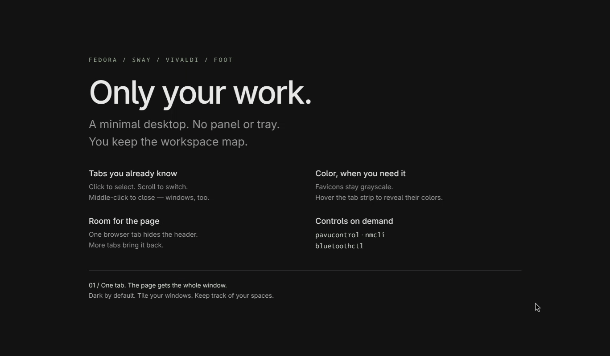

# A quiet Fedora desktop

Minimalistic Sway, Vivaldi and Foot. No visual clutter: no visible panel,
workspace strip, system tray, or row of settings buttons. Just your windows.



## How it feels

- **Windows behave like browser tabs.** Use `Super+w` for Sway's tabbed layout.
  Both tab strips support click to select, scroll to switch, and middle-click
  to close. `Super+e` returns to tiling.
- **Vivaldi stays out of the way.** One unstacked tab hides the whole browser
  header. More tabs bring it back. Favicons stay grayscale until you hover the
  tab strip, when their colors return.
- **Your browser preferences come along.** Mouse-wheel tab switching, tab layout,
  the dark theme, menu layout, hidden address/bookmark/panel bars, native window decorations
  and other portable UI choices are installed from [preferences.json](vivaldi/preferences.json).
  Browsing history, sessions, passwords and extensions stay on their own PC.
- **Foot matches the desktop.** A dark, plain terminal with minimal window
  borders. The first terminal starts `time.sh`, putting the time and free space
  in its title; another updater is never started while one is already running.
- **Keyboard and mouse both work.** Numbered workspaces, US/RU layout switching,
  middle-button workspace flicks, screenshots and screen recording are built in.

You keep track of your workspaces yourself. There is no always-visible workspace
map, network icon, volume widget, or Bluetooth menu. Open controls from a terminal
when you need them:

| Task | Command |
| --- | --- |
| Audio devices and volume | `pavucontrol` |
| Network and Wi-Fi | `nmcli` or `nmcli device wifi list` |
| Bluetooth | `bluetoothctl` |

## Install or update

**Tested only on Fedora Sway 42 and Fedora Sway Atomic 41.** The installer handles
packages, input-device access, Vivaldi installation and the preferences.
An existing Vivaldi installation is kept; otherwise Vivaldi is installed from Flathub.

```sh
curl -fsSL https://raw.githubusercontent.com/v4dkou/dotfiles/master/install.sh | bash
```

Run in a terminal as your normal desktop user and allow the package installation
when prompted. Close Vivaldi for its preferences to be applied. Then log out and
back in for the desktop environment and input permissions to take effect.
Rerun the same command for updates. Existing configurations are backed up.

## A few controls

| Action | Control |
| --- | --- |
| Open Foot | `Super+Enter` |
| Open the launcher | `Super+d` |
| Switch workspace | `Super+1` … `Super+0` |
| Move a window to a workspace | `Super+Shift+1` … `Super+Shift+0` |
| Tabbed windows / tiled windows | `Super+w` / `Super+e` |
| Focus a window | `Super+Arrow` or `Super+h/j/k/l` |
| Close a tab or window | Middle-click its tab or window border |
| Fullscreen | `Super+f` |
| Screenshot output / window / area to clipboard | `Shift+Print` / `Shift+Alt+Print` / `Shift+Ctrl+Print` |
| Record screen / selected area | `Super+Shift+Print` / `Super+Shift+Alt+Print` |
| Stop recording | `Super+Shift+F9` |

The GIF uses real Vivaldi and Foot windows on an isolated **1368×800** display.
Its recording source is [record-demo.py](scripts/record-demo.py). The browser CSS
also has a separate [visual regression check](scripts/verify-vivaldi.sh).
